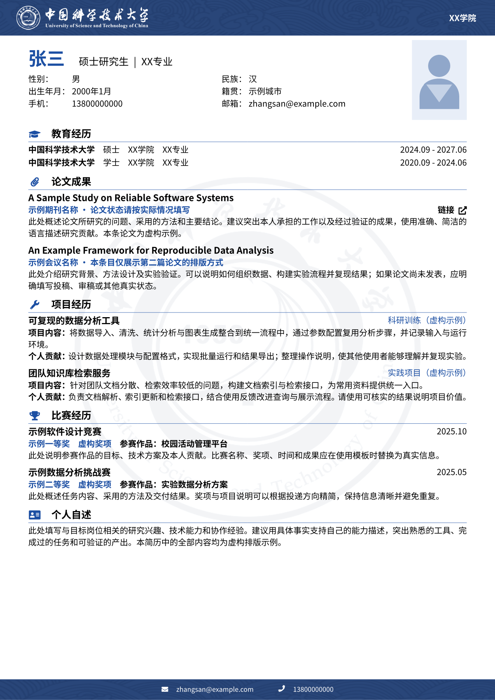
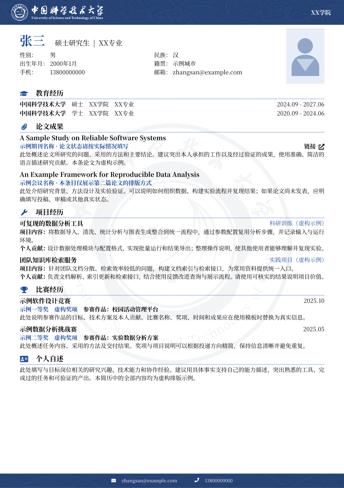
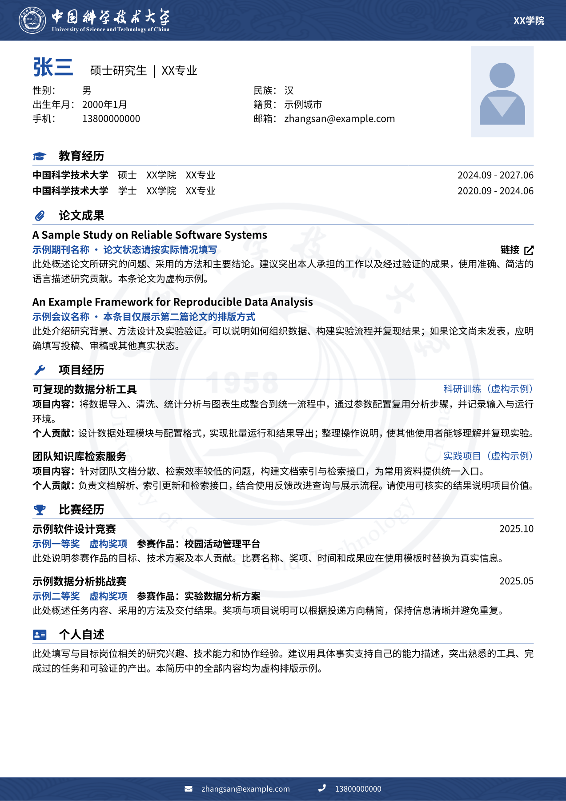
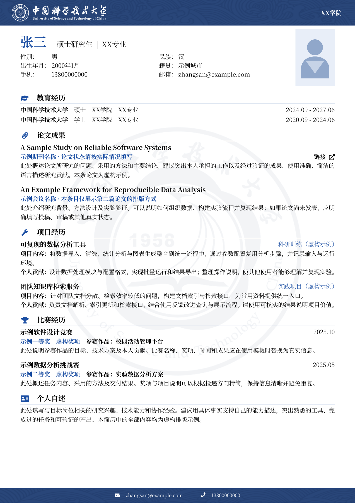

# resume-template-ustc-typst

非官方科大风格中文简历模板。日常只修改并编译 **`content.typ`**。
示例身份、联系方式、教育、论文、项目和奖项均为虚构，头像为通用占位图。

## 效果预览

以下四种效果使用相同的虚构示例内容。字体与密度均可在 `content.typ` 中切换。

| 排版密度 | 思源黑体（`sans`） | 思源宋体（`serif`） |
| --- | --- | --- |
| 标准（`standard`） |  |  |
| 舒展（`relaxed`） |  |  |

## 两个文件

- **`content.typ`**：个人信息和简历在前，全部参数在后，包含逐项中文注释。
- **`theme.typ`**：排版实现，通常无需修改。

其余目录为字体、图标、图片及许可文件，无额外 Typst 配置文件或构建脚本。

## 编译

需要 Typst 0.15.1 或更高版本。在项目目录运行：

```sh
typst compile --ignore-system-fonts --font-path fonts content.typ resume.pdf
```

生成的 `resume.pdf` 位于项目目录。
在编辑器或 Typst 网页端使用时，主文件选 `content.typ`，并提供 `fonts/` 中的字体。

## 修改方式

打开 `content.typ`，先填写前面的 `resume`，需要调整外观时再修改后面的 `settings`。每项参数旁均注明用途、单位或可选值：

1. **字体与密度**：`font` 选择 `sans`（思源黑体）或 `serif`（思源宋体）；`style` 选择 `compact`、`standard`、`relaxed`。
2. **字号和页面**：可调整正文、姓名、章节标题字号、主题色、页边距、照片宽度和水印。
3. **间距**：`global-spacing` 统一设置；`section-spacing` 分别设置教育、论文、项目、比赛和自述。旁边已写好可用参数及示例。
4. **章节与内容**：`sections` 控制显示顺序；`section-titles` 修改标题文字；`resume` 中填写简历。
5. **密度预设**：参数区末尾的 `density-presets` 保存三档密度的具体间距，可逐项定制。

可选字段省略或设为 `none`，空章节自动隐藏。单条论文、项目、比赛也可用 `spacing` 微调。
`max-pages: 1` 要求单页，超页时编译报错；`0` 表示不限制。密度不会自动将内容拉伸到页底。

## 来源与许可

- 基于 [JunyangZhangUSTC/LaTeX-CV-template-for-USTC](https://github.com/JunyangZhangUSTC/LaTeX-CV-template-for-USTC) 的科大风格，保留原 MIT 署名，代码许可见 `LICENSE`。
- 官方[思源黑体](https://github.com/adobe-fonts/source-han-sans)和[思源宋体](https://github.com/adobe-fonts/source-han-serif)按 SIL OFL 1.1 分发。完整许可在各字体子目录，来源与哈希见 `fonts/manifest.json`。
- [Font Awesome Free 5](https://fontawesome.com/) 图标按 CC BY 4.0 分发，许可见 `icons/LICENSE.txt`。

本项目为非官方模板。字体、图标保留各自许可，不因模板代码的 MIT 许可而改变。
